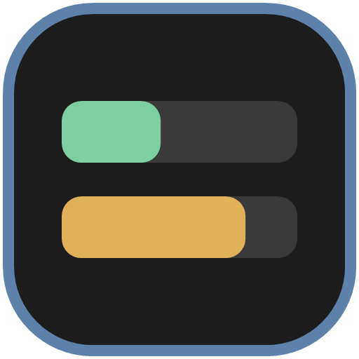

<p align="center">
  
</p>

# CursorMeter

O consumo do Cursor sempre à vista: duas barras, uma por pool de quota, sem abrires o painel Usage.


Cada barra é a quota desse pool no ciclo atual. Cursor Models corresponde a `autoPercentUsed`. Other Models corresponde a `apiPercentUsed`. São as mesmas duas percentagens do painel Usage.

Lê a sessão que o próprio Cursor gravou ao iniciares sessão, em `%APPDATA%\Cursor\User\globalStorage\state.vscdb`. Se essa sessão expirar, usa a sessão de cursor.com que estiver no Firefox. Não envia nada para além do pedido de uso ao próprio Cursor.

## Para quem é

No **Windows**, a aplicação foi pensada para o Windows 11 com o [Start11 v3](https://www.stardock.com/products/start11/), da Stardock. O Start11 v3 trouxe as "ilhas" da barra de tarefas: em vez de uma faixa de lado a lado, a barra passa a blocos arredondados, como num dock. O CursorMeter replica esse conceito e apresenta-se como mais uma ilha, com o mesmo aspeto das que o Start11 desenha.

No **Ubuntu**, é um ícone na área de notificação com as percentagens ao lado. Ver [Ubuntu](#ubuntu).

## Windows

### A configuração pensada

No Start11 v3, ativa as ilhas da barra de tarefas (Taskbar Islands) e usa o alinhamento **tudo ao centro**: o botão Iniciar e os ícones juntos numa ilha ao centro, e a área de notificação noutra, à direita. O espaço livre à esquerda fica para o CursorMeter, que ocupa o **canto esquerdo** como uma ilha própria e fica sempre fixo ali.

```
┌──────────────┐      ┌───────────────────────┐      ┌──────────────┐
│  CursorMeter │      │  Iniciar e ícones     │      │ Notificações │
└──────────────┘      └───────────────────────┘      └──────────────┘
  canto esquerdo           ao centro                    à direita
```

A ilha:

- **Encaixa sozinha.** A aplicação lê a forma que o Start11 dá à barra de tarefas (a região da janela) e deduz onde estão as ilhas, a altura e o raio dos cantos. Não usa valores fixos para o zoom ou a resolução, por isso acompanha o zoom de cada monitor. A margem à esquerda é igual à que a ilha da direita tem à direita.
- **Usa as cores do Start11.** O preenchimento, a cor e a espessura do contorno (1, 1,25, 1,5 ou 2 px) vêm das definições da barra de tarefas do Start11. Se as mudares, a ilha acompanha em poucos segundos. O contorno é suavizado e misturado com o fundo, como o do Start11.
- **Fica sempre visível.** A ilha não é tapada ao abrir o menu Iniciar do Start11, ao clicar num ícone da barra ou com uma janela maximizada. Só a Vista de Tarefas (Win+Tab) a tapa, como a qualquer outra janela, e volta logo ao fechar.
- **Fica fixa.** Não se arrasta. Clique abre o resumo, junto à ilha. Botão direito: atualizar, abrir o painel, iniciar com o Windows, sair.

Testado com o Start11 v3 beta, no Windows 11, a 125% de zoom, com a barra em baixo. A barra no topo ou vertical não usa o modo ilha.

### Sem o Start11 v3, ou sem ilhas

A aplicação continua a funcionar, com o comportamento anterior. Se as ilhas estiverem desligadas, se o Start11 não estiver instalado, ou se a primeira ilha começar encostada à esquerda e não houver espaço (alinhamento à esquerda), as barras aparecem numa caixa ao lado da área de notificação, junto ao relógio.

- **Windows 10:** as barras ficam dentro da barra de tarefas.
- **Windows 11:** o sistema não mostra uma janela metida na barra: à escala de 100% não aparece nada, e à de 125% só aparece porque o Windows a amplia. As barras são desenhadas por cima da barra, no mesmo sítio, e seguem a escala do monitor.
- **Menu Iniciar e Vista de Tarefas:** com o menu Iniciar do Windows aberto, ou com a Vista de Tarefas, o Windows põe a barra por cima de qualquer janela normal. As barras ficam no mesmo sítio: a área que ocupam deixa de fazer parte da barra enquanto o menu está aberto, e volta ao normal quando fecha. Um clique num ícone da barra também não as esconde.
- **Posição:** arrasta para reposicionar. Fica em `%LOCALAPPDATA%\CursorMeter\offset.txt`.

Se numa máquina não aparecerem, abre **Acerca de** no menu do botão direito: mostra a versão e o ficheiro de registos (`%LOCALAPPDATA%\CursorMeter\cursormeter.log`), que diz como as barras foram colocadas. O botão **Enviar registos** copia o registo e abre uma issue no GitHub.

### Instalar

A release traz um instalador para Windows de 64 bits. Não pede administrador: o programa fica em `%LOCALAPPDATA%\Programs\CursorMeter` e aparece em Aplicações instaladas. A posição das barras, quando não estás no modo ilha, continua em `%LOCALAPPDATA%\CursorMeter\offset.txt`, por isso uma reinstalação não a apaga.

O Windows pode dizer que o publicador é desconhecido, porque o instalador não está assinado. No assistente podes deixar marcado o arranque com o Windows. O mesmo interruptor está no menu do botão direito.

O Start11 é um produto da Stardock, pago e independente deste projeto. O CursorMeter não o inclui nem tem qualquer ligação à Stardock.

## Ubuntu

O pacote para Ubuntu de 64 bits é `CursorMeter-<versão>-linux-x64.tar.gz`. Não pede sudo nem precisa do .NET instalado:

```bash
tar -xzf CursorMeter-<versão>-linux-x64.tar.gz
cd CursorMeter-<versão>-linux-x64
./install.sh --autostart
```

O programa fica em `~/.local/share/cursormeter`, a entrada nas aplicações em `~/.local/share/applications` e o ícone em `~/.local/share/icons/hicolor/scalable/apps`. Com `--autostart` arranca com a sessão. O mesmo interruptor está no menu, "Iniciar com a sessão", e grava `~/.config/autostart/cursormeter.desktop`. Para desinstalar: `~/.local/share/cursormeter/uninstall.sh`.

No Ubuntu não há barras dentro do painel. Na área de notificação fica o ícone e, à direita dele, as duas percentagens em texto, por exemplo `Cursor 9% · Outros 43%`, arredondadas como as barras do Windows. Enquanto lê, aparece "A ler…". Se falhar antes de ter quotas, aparece o erro, por exemplo "Abre o Cursor" ou "Sem ligação". O texto atualiza-se de 3 em 3 minutos e em "Atualizar". O resumo abre no canto, junto ao painel, e fecha com Esc ou com um clique noutra janela.

O menu tem sempre, por esta ordem: Mostrar resumo, Atualizar, Painel do Cursor, Iniciar com a sessão, Sair. O que cada clique faz depende do painel:

- GNOME (extensão Ubuntu AppIndicators): o clique simples abre o menu, porque a extensão abre sempre o menu. O duplo clique e o botão do meio abrem e fecham o resumo. O botão direito abre o menu. Um clique na barra superior não fecha o resumo, e um clique no ambiente de trabalho só o fecha se os ícones do ambiente de trabalho estiverem ativos.
- Xfce, plugin Área de notificação: o clique abre e fecha o resumo, tal como o botão do meio. O botão direito abre o menu. Este plugin não mostra o texto, só o ícone. As percentagens ficam na dica do ícone.
- Xfce, plugin Indicadores (com `ayatana-indicator-application`): mostra o texto. O clique abre o menu e o botão do meio abre e fecha o resumo. O botão direito abre o menu do próprio painel.
- KDE Plasma: mostra o ícone, mas não o texto.

O ícone precisa de um painel com suporte para AppIndicator (StatusNotifierItem). O Ubuntu traz a extensão Ubuntu AppIndicators ativa por omissão. Noutras instalações do GNOME, instala `gnome-shell-extension-appindicator` e ativa-a nas Extensões. Xfce e KDE já mostram estes ícones.

A sessão vem de `~/.config/Cursor/User/globalStorage/state.vscdb`, gravada pelo Cursor, ou de `~/.config/cursor/auth.json`, gravada pelo Cursor CLI. Se `XDG_CONFIG_HOME` estiver definido, substitui `~/.config`. Se a sessão expirar, usa a de cursor.com no Firefox, procurada em `~/.mozilla/firefox`, `~/snap/firefox/common/.mozilla/firefox` (o Firefox snap do Ubuntu), `~/.var/app/org.mozilla.firefox/.mozilla/firefox` (Flatpak) e `~/.config/mozilla/firefox`.

Para compilar, com o .NET 8 SDK:

```bash
./scripts/build-linux.sh
```

O pacote sai em `dist/CursorMeter-<versão>-linux-x64.tar.gz`. O executável fica em `src/CursorMeter.App/bin/Release/net8.0/linux-x64/publish/CursorMeter`.

## Correr a partir do código

No Windows, com o [.NET 8 SDK](https://dotnet.microsoft.com/download/dotnet/8.0) e o [Inno Setup 6](https://jrsoftware.org/isdl.php) se fores gerar o instalador:

```powershell
.\scripts\build-windows.ps1
.\src\CursorMeter.App\bin\Release\net8.0\win-x64\publish\CursorMeter.exe
```

O instalador, `dist\CursorMeter-Setup-<versão>.exe`, sai de `.\scripts\build-installer.ps1`.

As barras aparecem na barra de tarefas, como descrito em [Windows](#windows).

## O que o .NET precisa de ter

- SDK .NET 8, para compilar. O projeto aponta para `net8.0`, sem workloads de Windows.
- A interface é [Avalonia](https://avaloniaui.net/) 11.3, que vem do NuGet. O Avalonia 12 exige uma SDK .NET 9.0.300 ou mais recente para compilar, por isso fica de fora enquanto o `global.json` fixar a SDK 8.
- Não é preciso o Windows App SDK nem o WinUI do TaskbarQuota.

A lógica (sessão, pedido, texto das percentagens, posição na barra, deteção das ilhas) está em `CursorMeter.Core` e corre em qualquer sistema. A leitura das cores do Start11 está em `src/CursorMeter.App/Windows/Start11Theme.cs`. O resumo e o menu são Avalonia e também correm em qualquer sistema. No Windows, o ícone na área de notificação também é Avalonia. No Linux, como o ícone do Avalonia não aceita texto, o ícone é um StatusNotifierItem próprio, em `src/CursorMeter.App/Linux`, e só volta ao do Avalonia se não houver sessão D-Bus. As barras dentro da barra de tarefas são Win32 e só existem no Windows (`src/CursorMeter.App/Windows`). O arranque com a sessão no Linux está em `src/CursorMeter.App/Linux`.

## Licença

[MIT](LICENSE). O Avalonia, a interface, tem a sua própria licença MIT.
