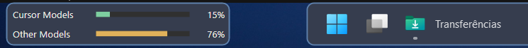

<p align="center">
  
</p>

# CursorMeter

Vê o consumo do Cursor sem abrir o painel Usage: duas barras discretas, uma por pool de quota, sempre à vista.



**[Transferir a última versão](https://github.com/brunorochaipca/cursor-meter/releases/latest)** · Windows 10 e 11 · Ubuntu 64 bits · [MIT](LICENSE)

## O que mostra

- **Cursor Models:** a quota do ciclo atual para esse pool (`autoPercentUsed`).
- **Other Models:** a quota do ciclo atual para os restantes modelos (`apiPercentUsed`).

São as mesmas duas percentagens do painel Usage. Clica nas barras para ver o resumo, e usa o botão direito para atualizar, abrir o painel ou mudar as definições.

## Instalar

### Windows

1. Transfere `CursorMeter-Setup-<versão>.exe` da [última release](https://github.com/brunorochaipca/cursor-meter/releases/latest).
2. Corre-o. Não pede administrador. O Windows pode dizer que o publicador é desconhecido, porque o instalador não está assinado: escolhe **Mais informações** e depois **Executar mesmo assim**.
3. Garante que o Cursor tem a sessão iniciada. As barras aparecem sozinhas na barra de tarefas.

No assistente podes deixar marcado o arranque com o Windows. O programa fica em `%LOCALAPPDATA%\Programs\CursorMeter` e aparece em Aplicações instaladas.

### Ubuntu

```bash
tar -xzf CursorMeter-<versão>-linux-x64.tar.gz
cd CursorMeter-<versão>-linux-x64
./install.sh --autostart
```

Não pede sudo nem precisa do .NET instalado. Fica um ícone na área de notificação com as percentagens ao lado, por exemplo `Cursor 9% · Outros 43%`. Para desinstalar: `~/.local/share/cursormeter/uninstall.sh`.

## Qual edição (Windows)?

| Tens | Instala |
|---|---|
| Windows 11 com o [Start11](https://www.stardock.com/products/start11/) v3 | **Island** (estável) |
| Windows 10 ou 11 sem Start11 | **Island** (estável) |
| Start11 v1 ou v2 | **Mainland** (beta), na [lista de releases](https://github.com/brunorochaipca/cursor-meter/releases) |

Com o Start11 v1 ou v2, abrir e fechar o menu Iniciar ou a Vista de Tarefas com o rato deixa a barra de tarefas por cima das barras do CursorMeter. A Mainland tem um modo administrador experimental que resolve isso. Ver [as duas edições](docs/edicoes.md).

Em Windows 11 com o Start11 v3, a ilha do CursorMeter encaixa entre as ilhas do Start11 e usa as cores delas. Ver [Windows e Start11](docs/windows.md).

## Privacidade

Lê a sessão que o próprio Cursor gravou ao iniciares sessão, em `%APPDATA%\Cursor\User\globalStorage\state.vscdb`. Se essa sessão expirar, usa a sessão de cursor.com que estiver no Firefox. Não envia nada para além do pedido de uso ao próprio Cursor.

## Algo não aparece?

Botão direito nas barras, **Acerca de**, **Enviar registos**: copia o registo e abre uma issue no GitHub. Mais ajuda em [resolução de problemas](docs/resolucao-de-problemas.md).

## Saber mais

- [Windows e Start11](docs/windows.md): ilhas, barras flutuantes, definições e modo sem ilhas.
- [Ubuntu](docs/ubuntu.md): painéis suportados, cliques e onde procura a sessão.
- [As duas edições](docs/edicoes.md) e o [modo administrador experimental](docs/mainland.md).
- [Compilar a partir do código](docs/compilar.md).

O Start11 é um produto da Stardock, pago e independente deste projeto. O CursorMeter não o inclui nem tem qualquer ligação à Stardock.

## Licença

[MIT](LICENSE). O Avalonia, a interface, tem a sua própria licença MIT.
