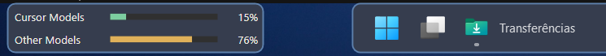

# Windows e Start11

A edição Island foi pensada para o Windows 11 com o Start11 v3, da Stardock. O Start11 v3 trouxe as "ilhas" da barra de tarefas: em vez de uma faixa de lado a lado, a barra passa a blocos arredondados, como num dock. O CursorMeter replica esse conceito e apresenta-se como mais uma ilha, com o mesmo aspeto das que o Start11 desenha.



## A configuração pensada

No Start11 v3, ativa as ilhas da barra de tarefas (Taskbar Islands) e usa o alinhamento **tudo ao centro**: o botão Iniciar e os ícones juntos numa ilha ao centro, e a área de notificação noutra, à direita. O espaço livre à esquerda fica para o CursorMeter, que ocupa o **canto esquerdo** como uma ilha própria e fica sempre fixo ali.

```
┌──────────────┐      ┌───────────────────────┐      ┌──────────────┐
│  CursorMeter │      │  Iniciar e ícones     │      │ Notificações │
└──────────────┘      └───────────────────────┘      └──────────────┘
  canto esquerdo           ao centro                    à direita
```

A ilha:

- **Encaixa sozinha.** A aplicação lê a forma que o Start11 dá à barra de tarefas (a região da janela) e deduz onde estão as ilhas, a altura e o raio dos cantos. Não usa valores fixos para o zoom ou a resolução, por isso acompanha o zoom de cada monitor. A margem à esquerda é igual à que a ilha da direita tem à direita.
- **Usa as cores do Start11.** O preenchimento, a cor e a espessura do contorno (1, 1,25, 1,5 ou 2 px) vêm das definições da barra de tarefas do Start11. Se as mudares, a ilha acompanha em poucos segundos. O contorno é suavizado e misturado com o fundo, como o do Start11.
- **Fica sempre visível.** A ilha não é tapada ao abrir o menu Iniciar do Start11, ao clicar num ícone da barra ou com uma janela maximizada. Só a Vista de Tarefas (Win+Tab) a tapa, como a qualquer outra janela, e volta logo ao fechar.
- **Fica fixa.** Não se arrasta. Clique abre o resumo, junto à ilha. Botão direito: atualizar, abrir o painel, iniciar com o Windows, sair.

Testado com o Start11 v3 beta, no Windows 11, a 125% de zoom, com a barra em baixo. A barra no topo ou vertical não usa o modo ilha.

## Outros alinhamentos do Start11

O Start11 também deixa alinhar os ícones à esquerda ou só os botões ao centro. A ilha das barras procura sempre espaço livre entre as ilhas do Start11, por esta ordem:

- **Tudo ao centro:** canto esquerdo, como acima.
- **Botões ao centro:** ao lado da ilha do Iniciar, entre ela e a ilha dos botões.
- **Alinhado à esquerda:** entre a ilha dos ícones e a área de notificação, encostada a esta.

Se o primeiro espaço não chegar, usa o maior que couber. Se nenhum couber, as barras flutuam (ver abaixo). Os estilos Sólido e Arredondado do Start11 não têm ilhas separadas e mantêm o comportamento da 1.2.6.

## Quando a ilha das janelas ocupa o espaço

Com muitas janelas abertas, a ilha dos ícones do Start11 cresce para a esquerda e deixa de haver espaço para a ilha das barras. Em vez de ficarem por cima dos ícones, as barras **flutuam por cima da barra de tarefas**, no canto esquerdo, mantendo o aspeto de ilha:

- **Esbatidas.** Ficam a cerca de 40% de opacidade e só ficam totalmente visíveis quando o rato passa por cima, para tapar o menos possível.
- **Arrastáveis.** Aqui podem-se arrastar para qualquer ponto do ecrã, também para outro monitor. A posição fica em `%LOCALAPPDATA%\CursorMeter\floating.txt`. Se esse monitor desaparecer, voltam ao canto esquerdo.
- **Escondíveis.** No menu (botão direito nas barras ou no ícone da área de notificação), "Esconder as barras flutuantes". Só vale enquanto não houver espaço para a ilha.
- **Voltam sozinhas.** Quando fechas janelas e a ilha volta a caber, as barras regressam ao canto da barra de tarefas. Pedem uns pixéis a mais para voltar do que para sair, para não oscilarem.

## Definições

Botão direito nas barras ou no ícone da área de notificação, **Definições…**. A janela é parecida com a do Start11: secções à esquerda, um cartão por definição e, em cima, uma pré-visualização das barras que acompanha cada alteração. Tudo se aplica logo e fica em `%LOCALAPPDATA%\CursorMeter\settings.txt`.

- **Aspeto:** tema (Automático, Escuro, **Transparente** ou Seguir o Start11, que no estilo Arredondado ou Sólido deixa as barras diretamente na barra, sem caixa), opacidade do fundo, contorno, cantos, tamanho do texto, mostrar uma só pool e mostrar o que resta em vez do que usaste.
- **Cores:** texto, texto secundário, as duas pools, aviso, crítico e contorno. Para o tema transparente, escolhe um texto claro ou escuro conforme a tua barra de tarefas.
- **Utilização e alertas:** de quanto em quanto tempo lê a quota (1, 3, 5 ou 10 minutos) e a partir de que valor a barra passa a aviso (70% por omissão) e a crítico (90%).
- **Barras flutuantes:** opacidade em repouso, esconder e repor a posição.
- **Geral:** iniciar com o Windows, esconder as barras em ecrã inteiro (ligado por omissão) e repor todas as definições. Com isto ligado, as barras desaparecem enquanto um jogo, um vídeo ou outra aplicação ocupa o ecrã todo e voltam quando ela sai. A app usa o mesmo estado do Windows que suspende as notificações nessa situação, por isso uma janela só maximizada não conta.

O tema, a opacidade, o contorno e os cantos valem só **fora do modo ilha**: na caixa junto ao relógio, no Windows 10 e quando as barras flutuam. Como ilha da barra de tarefas, as barras seguem sempre as cores do Start11. O tema transparente não foi testado no Windows 10.

## Sem o Start11 v3, ou sem ilhas

A aplicação continua a funcionar, com o comportamento anterior. Se as ilhas estiverem desligadas (estilo Sólido ou Arredondado), se o Start11 não estiver instalado, ou se não houver espaço, as barras aparecem numa caixa ao lado da área de notificação, junto ao relógio.

- **Windows 10:** as barras ficam dentro da barra de tarefas.
- **Windows 11:** o sistema não mostra uma janela metida na barra: à escala de 100% não aparece nada, e à de 125% só aparece porque o Windows a amplia. As barras são desenhadas por cima da barra, no mesmo sítio, e seguem a escala do monitor.
- **Menu Iniciar e Vista de Tarefas:** com o menu Iniciar do Windows aberto, ou com a Vista de Tarefas, o Windows põe a barra por cima de qualquer janela normal. As barras ficam no mesmo sítio: a área que ocupam deixa de fazer parte da barra enquanto o menu está aberto, e volta ao normal quando fecha. Um clique num ícone da barra também não as esconde.
- **Posição:** arrasta para reposicionar. Fica em `%LOCALAPPDATA%\CursorMeter\offset.txt`.

## Instalador

Os instaladores não pedem administrador (a Mainland só pede, para registar o arranque, se ativares o modo experimental). O programa fica em `%LOCALAPPDATA%\Programs\CursorMeter`. A posição das barras, quando não estás no modo ilha, continua em `%LOCALAPPDATA%\CursorMeter\offset.txt`, por isso uma reinstalação não a apaga. O mesmo interruptor de arranque com o Windows está no menu do botão direito.
